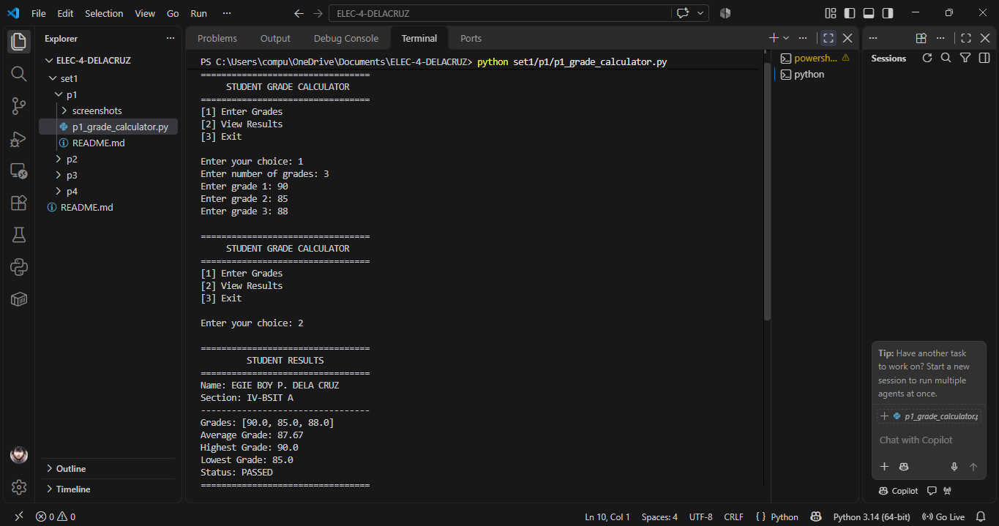
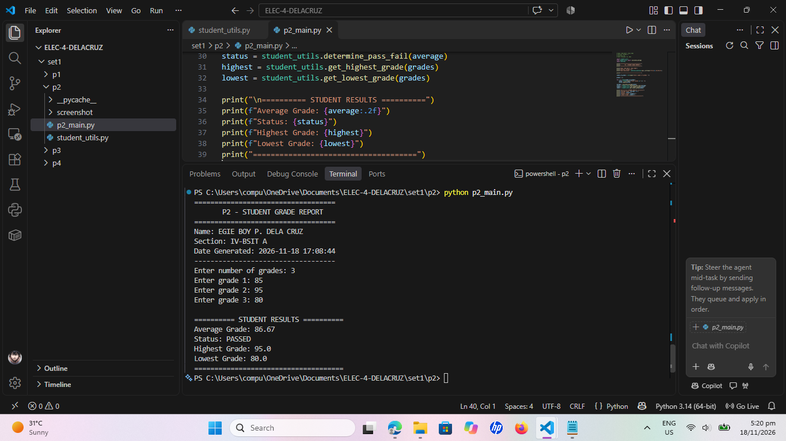
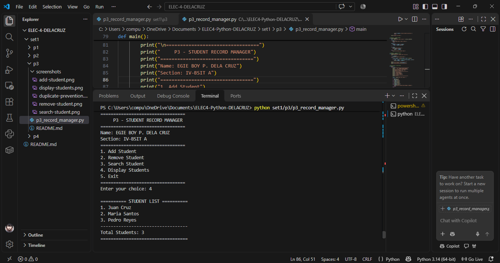
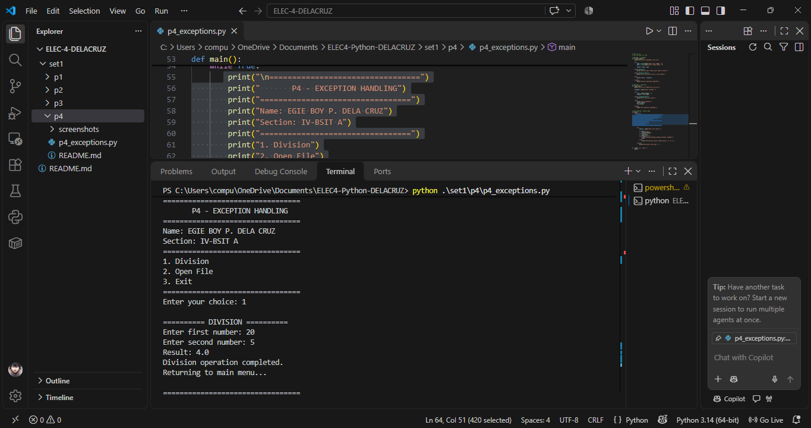

# ELEC 4 - Python Programming

**Name:** EGIE BOY P. DELA CRUZ  
**Section:** IV-BSIT A  
**Course:** ELEC 4 - Python Programming

---

## Set 1 Activities

| Activity | Description | Folder |
|---|---|---|
| P1 - Grade Calculator | A menu-driven program that calculates the average, highest grade, lowest grade, and pass/fail status. | [P1 Folder](set1/p1/) |
| P2 - Student Grade Report | A program that uses a custom Python module to calculate and display student grade results. | [P2 Folder](set1/p2/) |
| P3 - Student Record Manager | A program that uses lists and sets to add, search, remove, and display student records. | [P3 Folder](set1/p3/) |
| P4 - Exception Handling | A program demonstrating try, except, else, and finally. | [P4 Folder](set1/p4/) |

---

## How to Run the Activities

Run each command from the repository root directory.

### P1 - Grade Calculator
```bash
python set1/p1/p1_grade_calculator.py
```

### P2 - Student Grade Report
```bash
python set1/p2/p2_main.py
```

### P3 - Student Record Manager
```bash
python set1/p3/p3_record_manager.py
```

### P4 - Exception Handling
```bash
python set1/p4/p4_exceptions.py
```

---

## Screenshots

### P1 - Grade Calculator



### P2 - Student Grade Report



### P3 - Student Record Manager



### P4 - Exception Handling



---

## Author

**EGIE BOY P. DELA CRUZ**  
**Section:** IV-BSIT A  
**Course:** ELEC 4 - Python Programming