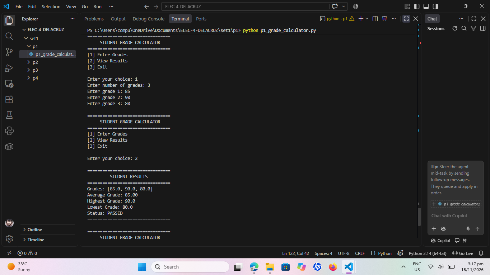

# P1 - Student Grade Calculator

**Name:** EGIE BOY P. DELA CRUZ  
**Section:** IV-BSIT A  
**Course Code and Title:** ELEC 4 - Python Programming

## P1 - Student Grade Calculator

**Description:**

A Python program that allows users to enter student grades, calculate the average, get the highest and lowest grades, and determine whether the student passed or failed.

**How to Run:**

```bash
python p1_grade_calculator.py
```

**Features:**
1. Accept student grades from 0 to 100.
2. Calculate the average grade.
3. Get the highest grade.
4. Get the lowest grade.
5. Determine pass or fail using 75 as the passing average.
6. Display results using a menu.
7. Continue running until the user selects Exit.

**Screenshots:**

### P1 Student Grade Calculator Output



**Author:** EGIE BOY P. DELA CRUZ  
**Section:** IV-BSIT A