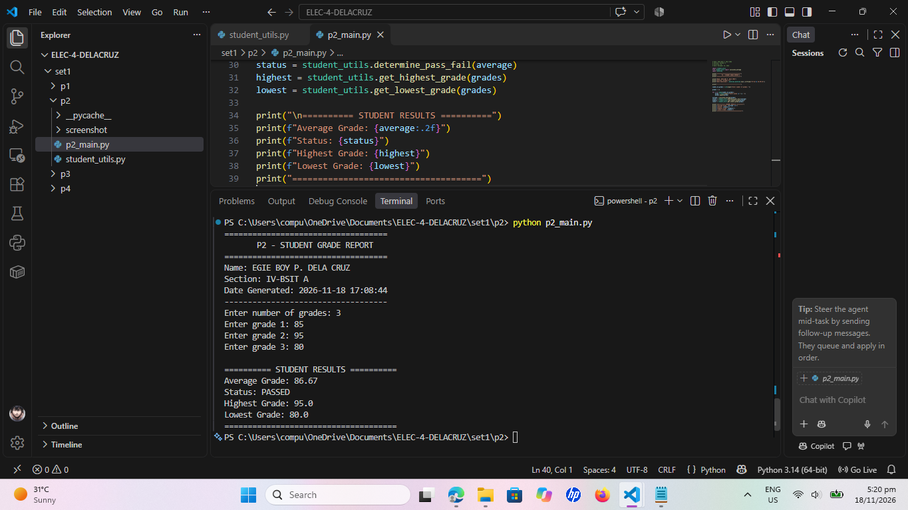

# P2 - Custom Module: student_utils

**Name:** EGIE BOY P. DELA CRUZ  
**Section:** IV-BSIT A  
**Course:** ELEC 4 - Python Programming

## Description

This activity demonstrates how to create and use a custom Python module named `student_utils`. The module contains functions for calculating the average grade, determining pass or fail status, and getting the highest and lowest grades.

## Files

- `student_utils.py` – Contains the four custom functions.
- `p2_main.py` – Main program that imports and uses the custom module.

## Features

- Calculate average grade.
- Determine pass or fail status.
- Get the highest grade.
- Get the lowest grade.
- Use Python's built-in `datetime` module.
- Demonstrate `import module` and `from module import name`.

## How to Run

Open the terminal inside the P2 folder and execute:

```bash
python p2_main.py
```

## Testing

### Test 1 – Passed Condition

The program was tested using three sample grades:

- Grade 1: 85
- Grade 2: 95
- Grade 3: 80

**Expected Results:**

- Average Grade: 86.67
- Status: PASSED
- Highest Grade: 95.0
- Lowest Grade: 80.0

### Test 2 – Failed Condition

The program was also tested using the following sample grades:

- Grade 1: 60
- Grade 2: 70
- Grade 3: 74

**Actual Results:**

- Average Grade: 68.00
- Status: FAILED
- Highest Grade: 74.0
- Lowest Grade: 60.0

**Result:** The program correctly identified the student as FAILED because the average grade was below 75.

## Screenshot



## Author

EGIE BOY P. DELA CRUZ  
IV-BSIT A