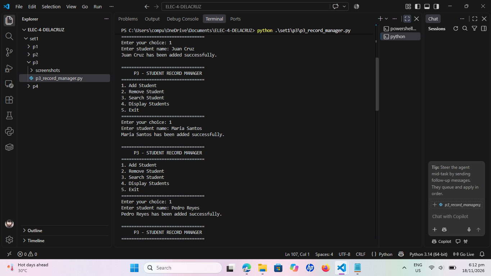
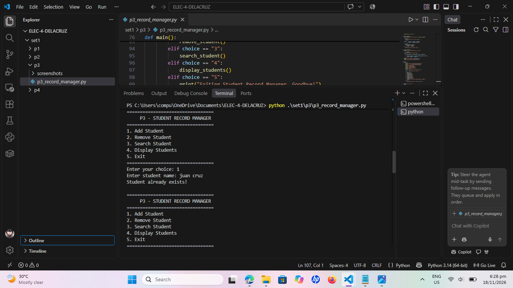
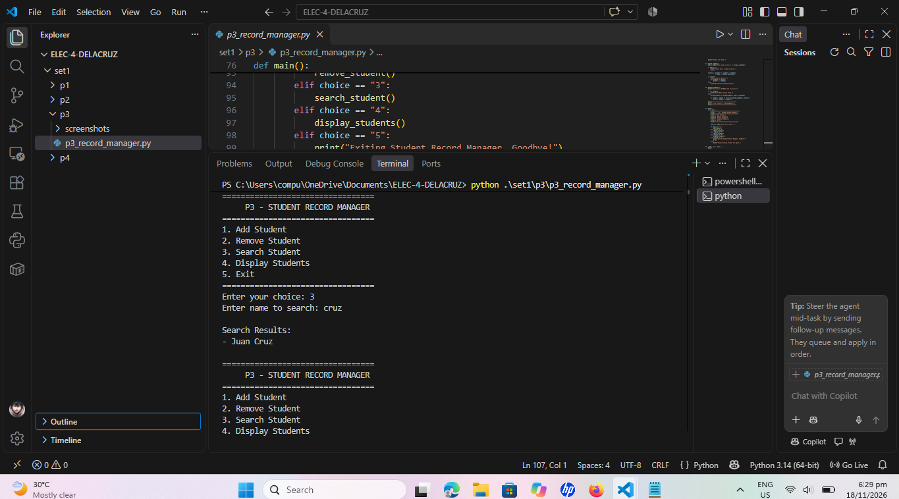
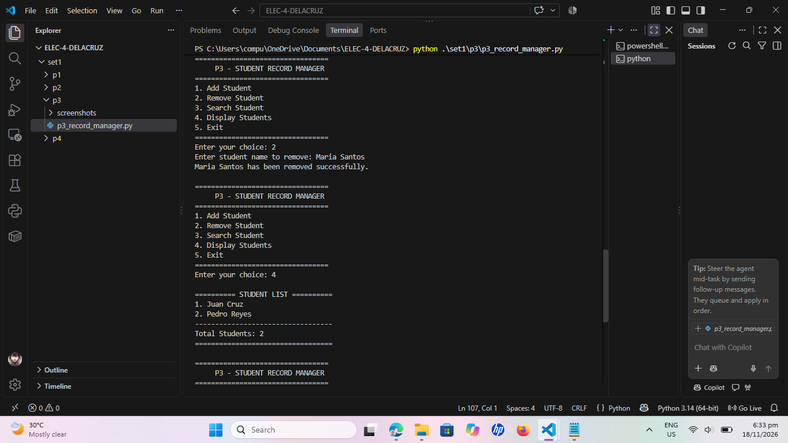
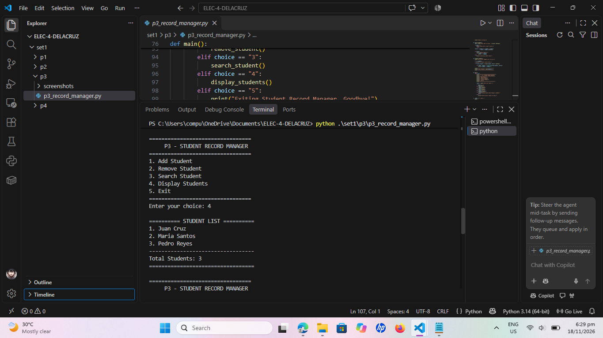

# P3 - Student Record Manager

**Name:** EGIE BOY P. DELA CRUZ  
**Section:** IV-BSIT A  
**Course:** ELEC 4 - Python Programming  
**Activity:** P3 - Student Record Manager  
**Date:** November 18, 2026

## Description

This program is a menu-driven Student Record Manager developed using Python. It allows users to add, remove, search, and display student names. It uses a list to store student records and a set to prevent duplicate student names.

## Features

1. **Add Student** - Adds a new student name to the records.
2. **Remove Student** - Removes an existing student name.
3. **Search Student** - Searches for students using full or partial names.
4. **Display Students** - Displays all student names alphabetically with numbering and total count.
5. **Duplicate Prevention** - Prevents duplicate names regardless of uppercase or lowercase letters.
6. **Exit** - Closes the program.

## Files

- `p3_record_manager.py` - Main Python source code.
- `README.md` - Project documentation.
- `screenshots/` - Screenshots showing the actual program execution.

## How to Run

1. Open the project folder in VS Code.
2. Open the terminal.
3. Run the following command:

```bash
python p3_record_manager.py
```

## Screenshots

### 1. Add Student



### 2. Duplicate Prevention



### 3. Search Student



### 4. Remove Student



### 5. Display Students



## Author

**EGIE BOY P. DELA CRUZ**  
IV-BSIT A
