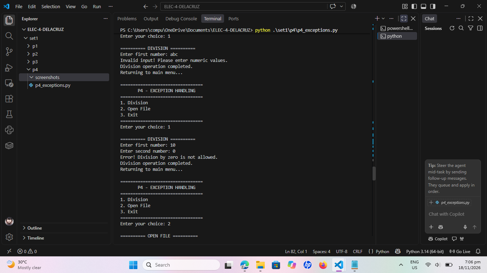
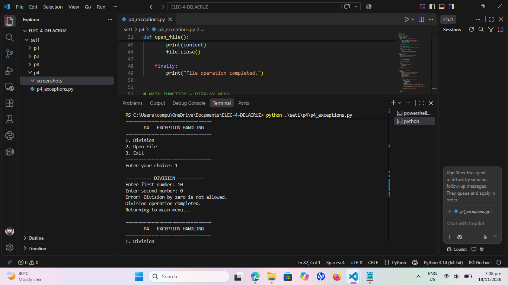
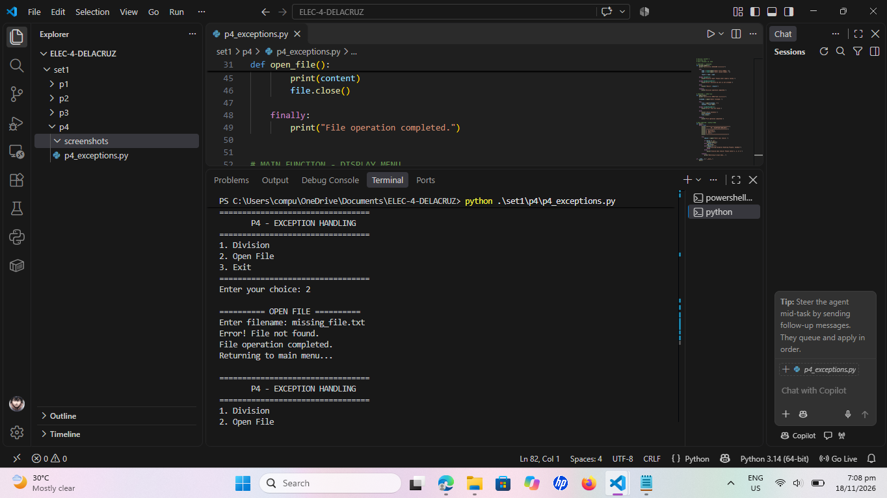
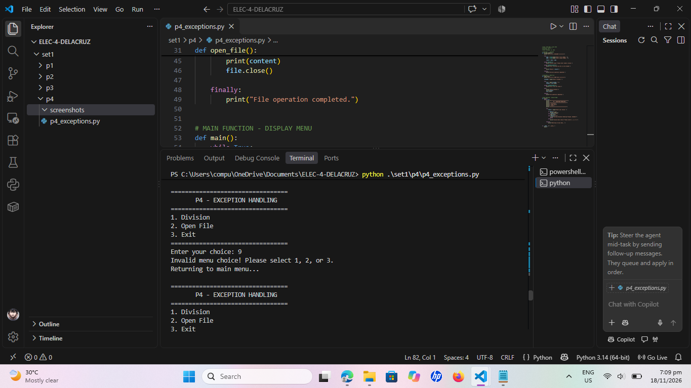
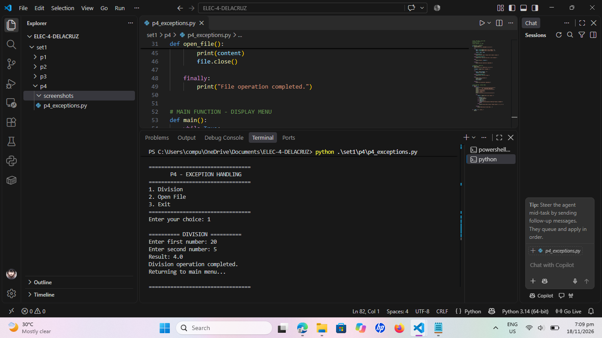
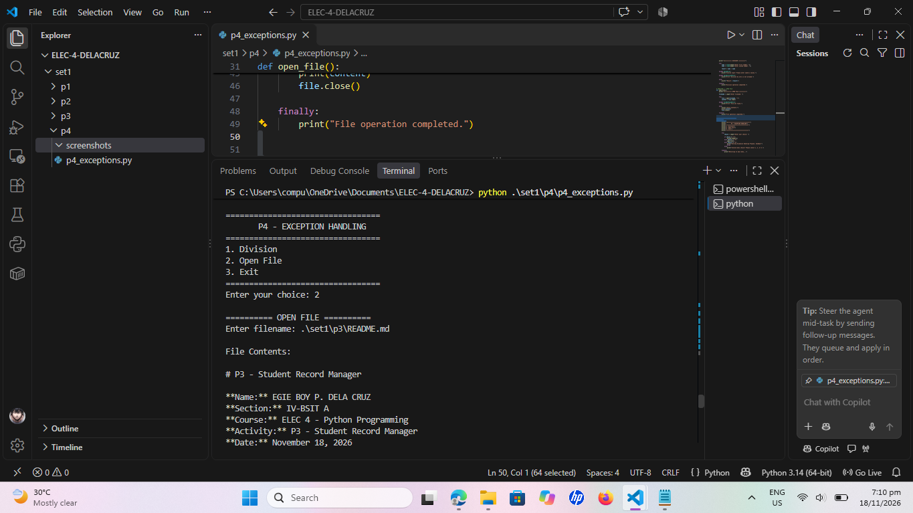

# P4 - Exception Handling

**Name:** EGIE BOY P. DELA CRUZ  
**Section:** IV-BSIT A  
**Course:** ELEC 4 - Python Programming  
**Activity:** P4 - Exception Handling  
**Date:** November 18, 2026

## Description

This program is a menu-driven Exception Handling application developed using Python. It demonstrates how to handle common runtime errors using try, except, else, and finally statements. It provides a division operation and a file-opening operation while preventing the program from crashing when errors occur.

## Features

1. **Division** - Accepts two numeric values and calculates their quotient.
2. **ValueError Handling** - Handles invalid non-numeric input.
3. **ZeroDivisionError Handling** - Prevents division by zero.
4. **Open File** - Opens a text file and displays its contents.
5. **FileNotFoundError Handling** - Displays an error message when the requested file does not exist.
6. **Invalid Menu Choice** - Displays an error message for invalid menu selections.
7. **Try, Except, Else, and Finally** - Demonstrates Python exception-handling statements.

## Exception Types Handled

| Exception | Description |
|---|---|
| ValueError | Occurs when non-numeric input is entered for division. |
| ZeroDivisionError | Occurs when the second number is zero. |
| FileNotFoundError | Occurs when the requested file cannot be found. |

## Files

- `p4_exceptions.py` - Main Python source code.
- `README.md` - Project documentation.
- `screenshots/` - Screenshots showing the actual program execution.

## How to Run

1. Open the project folder in VS Code.
2. Open the terminal.
3. Run the following command:

```bash
python p4_exceptions.py
```

## Screenshots

### 1. Invalid Number (ValueError)



### 2. Division by Zero (ZeroDivisionError)



### 3. Missing File (FileNotFoundError)



### 4. Invalid Menu Choice



### 5. Successful Division



### 6. Open Existing File



## Author

**EGIE BOY P. DELA CRUZ**  
IV-BSIT A
